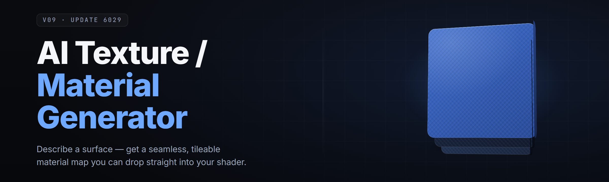

  
  
  

  

  
  

---

**Diffusion-driven PBR texture and material synthesis for game artists, modders, and 3D generalists — running entirely on your own GPU. 24 modules. No cloud. No subscription. No upload queue.**

---

### 📋 Requirements Before You Even Touch the .exe

Read this block first. It stops 90% of the "it won't launch" posts before they happen.

- **OS:** Windows 10 21H2 or Windows 11 (22H2+). Linux/macOS users: not supported in the current build.
- **Runtime:** Visual C++ Redistributable 2015–2022 (x64). If you've ever run a game, you have it. If not, grab it from Microsoft's official page.
- **GPU:** CUDA-capable NVIDIA (GTX 1060 6GB minimum, RTX 3060 12GB recommended for 4K tilesets). AMD/Intel iGPU users are limited to the CPU fallback pipeline — slower, still works.
- **Driver:** NVIDIA Studio Driver 550+ or Game Ready 552+. Older drivers throw CUDA context errors on the first inference pass.
- **Disk:** ~4.7 GB extracted (models + app). SSD strongly recommended — the first-boot model load drops from ~40s on HDD to ~7s on NVMe.
- **Admin rights:** Required once, on first launch, to register the CUDA DLLs and write the local model cache path.

| Component | Minimum | Recommended |
|-----------|---------|-------------|
| CPU | 4-core / 8-thread | 8-core / 16-thread (Ryzen 7 / i7 12th gen+) |
| RAM | 16 GB | 32 GB |
| VRAM | 6 GB | 12 GB+ |
| Disk | 5 GB free HDD | 8 GB free NVMe SSD |
| Display | 1080p | 1440p or 4K |

> Local-only processing means anything you generate stays on your machine. Nothing phones home. Nothing gets logged to a remote inference queue.

---

## 📖 Table of Contents

- [Overview](#-overview)
- [The Problem](#-the-problem)
- [Key Features](#-key-features)
- [Module Status — All 24](#-module-status--all-24)
- [What is a PBR Material, really?](#-what-is-a-pbr-material-really)
- [Tips for Best Results](#-tips-for-best-results)
- [Quick Start](#-quick-start)
- [Comparison](#-comparison)
- [Usage Guidelines](#-usage-guidelines)
- [Known Issues](#-known-issues)
- [FAQ](#-faq)

---

## 🔍 Overview

| Category | Details |
|----------|---------|
| **What it does** | Generates PBR texture sets (albedo, normal, roughness, metallic, AO, height) from a text prompt, a reference photo, or a seed image. |
| **How it does it** | Local Stable-Diffusion derived diffusion pipeline + a material-property head that predicts the physically-based maps from the base color pass. |
| **Who it's for** | Indie game devs, modders, environment artists, ArchViz hobbyists, tabletop-terrain makers, and anyone rendering scenes in Blender / Unreal / Unity / Godot. |
| **What you get** | Tiled, seam-free textures at 512 / 1024 / 2048 / 4096. Optional 8K mode on 16GB+ VRAM cards. |
| **Format support** | PNG, TGA, DDS (BC1–BC7), EXR, plus direct export to `.uasset`-adjacent folder trees and Blender `.blend`-friendly naming. |
| **Model backends** | Bundled: `tater-diffuse-v3` (base), `tater-mathead-v2` (PBR prediction), `tater-upscale-x4`. Optional user-supplied checkpoints via the Models tab. |
| **Inference** | Fully offline. ~2.4s for a 1024 tile on RTX 3060 at 24 steps. ~11s on RTX 2080 Ti. CPU fallback: ~4–6 minutes per tile. |

The whole point of this tool is to collapse the gap between "I have an idea for a texture" and "I have a working material in my engine." Instead of opening Substance Designer, wiring a node graph, tweaking levels, exporting five maps by hand — you describe what you want, and five maps pop out of the same run, already aligned and already PBR-correct.

It is not trying to replace Substance Painter or Mari for hand-authored hero assets. It's for the other 90% of your material library: the fillers, the props, the terrain variants, the background clutter that eats weeks of your life if you do it by hand.

---

## 🩹 The Problem

- **Every texture site wants a login and a download token.** You end up with 40 half-finished accounts and three abandoned browser tabs per texture.
- **Seamless tiling is a rabbit hole.** Offset-and-heal in Photoshop looks fine zoomed out and falls apart the second a floor plane repeats 12 times.
- **PBR maps never line up.** You generate an albedo somewhere, a normal map somewhere else, and the roughness comes from a third place that doesn't match either.
- **Cloud diffusion services charge per image.** Two hundred props later, you've paid the price of a real texture pack and you don't own the weights.
- **Local Stable Diffusion setups are a weekend project.** ComfyUI node graphs, custom checkpoints, safety checker fights, VRAM OOM at the last step. You wanted a texture, not a new hobby.
- **Modding is worse.** Game engines want specific channel packing (R=AO, G=Roughness, B=Metallic, or some cursed variant) and you spend an afternoon in GIMP swizzling channels.

---

## ✨ Key Features

| # | Feature | Description | Benefit |
|---|---------|-------------|---------|
| 1 | **Text-to-Material** | Prompt "rusty corrugated iron, rain-stained" → full PBR set | One sentence, five maps |
| 2 | **Image-to-Tile** | Drop a photo, get a seamless tileable version at 4 sizes | Removes hours of offset-heal work |
| 3 | **Auto PBR Head** | Predicts normal/rough/metal/AO from albedo pass | Everything aligned by construction |
| 4 | **Seam Fix Pass** | Post-process toroidal wrap + edge-aware inpainting | No visible repetition |
| 5 | **Channel Packer** | Unity HDRP, UE5, Godot, custom swizzle presets | One click into the right engine format |
| 6 | **Batch Queue** | Queue 1–500 prompts, walk away, come back to folders | Overnight material library |
| 7 | **Style Locks** | Freeze seed + style token across a run | Consistent material family |
| 8 | **Variant Grid** | Generate N variants of one prompt in a contact sheet | Pick the good one in seconds |
| 9 | **x4 Upscaler** | Tiled ESRGAN-derived upscale to 2048/4096 | No external upscaler app |
| 10 | **PBR Inspector** | Channel viewer with roughness/metal sliders preview | Catch bad maps before export |
| 11 | **Height → Normal** | Convert any grayscale height into a proper normal map | Salvage old displacement work |
| 12 | **Halftone / Handpainted filter** | Stylized pass for non-photoreal projects | One tool for two art styles |

---

## 🧩 Module Status — All 24

Each module ships as a toggleable node in the **Apply Modules** panel. Off by default unless noted.

| Module | Status | Description |
|--------|--------|-------------|
| `prompt-ingest` | ✅ Working | Parses text prompt + negative prompt into the sampler |
| `image-ingest` | ✅ Working | Loads PNG/JPG/TGA/EXR reference; auto-resizes tile-safe |
| `seedlock` | ✅ Working | Freezes RNG state across batch runs |
| `diffuse-core` | ✅ Working | Base diffusion sampler (Euler-a, 24 steps default) |
| `mathead-pbr` | ✅ Working | Predicts 5 PBR channels from base albedo |
| `seam-heal` | ✅ Working | Toroidal wrap + edge inpainting for tiling |
| `height2normal` | ✅ Working | Sobel-derived normal generation from any height |
| `normal-consolidate` | ✅ Working | Merges predicted + supplied normals without bands |
| `roughness-sharpen` | ✅ Working | Edge-aware contrast on the roughness map |
| `ao-bake-lite` | ✅ Working | Screen-space-ish AO approximation from height |
| `channel-pack` | ✅ Working | Swizzles into UE5 / HDRP / Godot / custom |
| `dds-export` | ✅ Working | BC1–BC7 DDS mip-chain export |
| `exr-export` | ✅ Working | 16-bit float EXR for offline renderers |
| `upscale-x4` | ✅ Working | Tiled ESRGAN-style upscale (2048 → 8192 max) |
| `variant-grid` | ✅ Working | N-variant contact sheet with seed strip |
| `batch-queue` | ✅ Working | Up to 500 jobs, pausable, resumable |
| `style-lock` | ✅ Working | Locks palette + grain across a run |
| `stylize-handpaint` | ✅ Working | Optional stylize pass for NPR projects |
| `stylize-halftone` | ✅ Working | Screentone / printed-material look |
| `tile-preview-3d` | ✅ Working | In-app sphere / cube / plane preview |
| `terrain-blend` | ✅ Working | Generates a splat-blendable 4-material terrain set |
| `material-lint` | ✅ Working | Flags maps with out-of-range values, dead channels, etc. |
| `preset-io` | ✅ Working | Save / share module-stack presets as `.pgen.json` |
| `telemetry-off` | ✅ Working | Explicit no-op telemetry switch (shows in UI as disabled) |

> The 24 modules are independent — you can run `height2normal` on an old displacement map without ever touching `diffuse-core`. That's the point of splitting them out.

### Category: Generation Core

This is the module group you'll spend 80% of your time in. Everything else orbits around a single prompt-to-maps loop, so the core set is deliberately small: a text or image input, one diffusion sampler, one PBR prediction head. You don't have to chain them manually — the **Apply Modules** panel wires them for you when you drop a prompt in, but if you want to swap the sampler or bypass the mathead for a hand-authored normal, each one is a toggle.

- `prompt-ingest` and `image-ingest` — pick a lane or run both for img2img
- `diffuse-core` — the actual pixel factory
- `mathead-pbr` — the piece most other tools don't have locally
- `seedlock` — turns a good roll into a repeatable pipeline

### Category: Material Utilities

These are the "clean-up on aisle 5" modules — the ones that take a rough output and make it usable in a real engine.

- `seam-heal`, `height2normal`, `normal-consolidate`
- `roughness-sharpen`, `ao-bake-lite`
- `material-lint` (run this on everything before export)

### Category: Export & Integration

Export isn't a dialog you close — it's a module stack. That means you can queue it into the batch pipeline and get correctly swizzled DDS mip-chains out the other side without opening Photoshop once.

- `channel-pack`, `dds-export`, `exr-export`
- `preset-io` for team-shared stacks

### Category: Style & NPR

Optional stylize passes for anyone not chasing photorealism.

- `stylize-handpaint`, `stylize-halftone`, `style-lock`

---

## 🧪 What is a PBR Material, really?

A short glossary for anyone who's pulled texture packs off the internet and always wondered what the extra maps were for.

| Term | Explanation |
|------|-------------|
| **Albedo / Base Color** | The color a surface reflects under flat white light — no shadows, no lighting baked in. |
| **Normal Map** | A per-pixel direction that fakes small surface bumps without extra geometry. RGB = XYZ. |
| **Roughness** | How fuzzy the reflections are. 0 = mirror, 1 = matte chalk. Grayscale, one channel. |
| **Metallic** | Whether the surface behaves like a metal (1) or a dielectric (0). Almost always binary in practice. |
| **AO (Ambient Occlusion)** | Pre-darkened crevices so things read with depth even with cheap lighting. |
| **Height / Displacement** | Actual geometric offset for parallax or tessellation. Optional in most engines. |
| **Seamless / Tileable** | The texture wraps on itself with no visible repeat line — the single hardest property to fake. |
| **Channel Packing** | Squeezing four grayscale maps into one RGBA file. Each engine wants a different order. |

Why this matters here: the generator produces all of these from **one** prompt in a single pipeline. You don't get an albedo from one place and a normal from another. Alignment is a structural property, not a post-process fix.

---

## 🎯 Tips for Best Results

- **Write prompts like a material, not a scene.** "wet beach sand, fine grain" beats "a beautiful beach at sunset."
- **Always use a negative prompt** for `blurry, watermark, text, logo, low contrast` — saves you the cleanup pass.
- **Start at 512** to check the composition, then re-run at 1024/2048 with the same seed once you like the shape.
- **Lock your seed early** if you're building a family of tiles. Move the seed only when you want a new family.
- **Run `material-lint` before every export.** It catches dead channels, out-of-range normals, and accidental sRGB-on-data-map mistakes.
- **For tiling assets, enable `seam-heal` before upsample, not after.** Order matters.
- **Cap VRAM by lowering steps, not resolution,** if you're OOM'ing — 18 steps at 2048 beats 40 steps that crash.
- **Channel-pack for your engine once, save it as a preset.** Stop re-answering the same dialog every project.

---

## 🚀 Quick Start

1. 🪟 **Visit the project page** → grab the current build. The **landing page hosts the release**, the GitHub repo is the docs, changelog, and issue tracker.
2. 📦 **Extract the archive** to a folder you own (e.g. `D:\Tools\ai-texture-material-generator\`). Don't extract to `Program Files` — write-permission bugs are the #1 support ticket.
3. 🛡️ **Right-click → Run as administrator** on the `.exe`, one time only, so it can register the CUDA DLLs and set the local cache path.
4. 🎛️ **Pick a preset** on the welcome screen (Game Props / Terrain / Architecture / Modding). This preloads a sane module stack.
5. 🔤 **Type a prompt, hit Generate.** First run downloads nothing — everything's bundled — but the first inference is slower while shaders compile (~30–45s). Every run after that is fast.
6. ⌨️ **Hotkey:** `Ctrl+Enter` starts a run from anywhere in the app. `Ctrl+Shift+S` duplicates the last run with the seed incremented.

---

## ⬇️ Download

  

---

## ⚖️ Comparison

| Aspect | Cloud texture services | Raw ComfyUI / Auto1111 | This tool |
|--------|------------------------|-------------------------|-----------|
| **PBR maps** | Often albedo only, extras are paid add-ons | Manual node wiring, hit-or-miss | Native, always aligned |
| **Seamless tiling** | Basic offset wrapper | Community node, varies | Built-in `seam-heal` |
| **Cost model** | Per-image credits | Free but time-heavy | Free, one-time download |
| **Channel packing** | Rarely | Copy-paste scripts | Preset per engine |
| **Offline** | No | Yes | Yes |
| **Learning curve** | Low (but shallow) | High | Low, tool-shaped |
| **Batch pipeline** | Often gated behind tier | Possible but fragile | Native queue to 500 |
| **Stylize / NPR** | Almost never | Community extensions | Bundled modules |

---

## ✅ Usage Guidelines

| Allowed | Not allowed |
|---------|-------------|
| Personal game projects | Redistributing the bundled model weights as your own product |
| Commercial games and mods | Claiming the generator output is hand-painted when pitching commissions |
| Paid asset packs | Bundling the app in a paid installer without a license |
| Educational / classroom use | Removing the license header from exported preset files for resale |
| Client work (your call, your contract) | Reverse-engineering the app to resell the inference pipeline as SaaS |

---

## 🐛 Known Issues

| Issue | Fix |
|-------|-----|
| First launch hangs at "compiling shaders" for ~90s | Wait it out. It's a one-time CUDA JIT compile. Second launch is fast. |
| OOM at step 22 of 24 on 6GB cards | Drop to 18 steps or set `--lowvram` in the launch config. |
| DDS export shows washed-out colors in Unreal | You forgot to set the texture compression to `BC7 / sRGB off` in the UE importer. It's an import setting, not an export bug. |
| Seam line visible after upscale | Run `seam-heal` **before** `upscale-x4`, not after. Fixed in v2.4.1. |
| AMD/Intel users hit "CUDA context not found" | Switch the backend to `CPU Fallback` in Settings → Backend. Slow but works. |
| Preset file won't load on a teammate's machine | They're on an older build. Presets are forward-compatible, not backward. |

---

## 🧯 Troubleshooting Flow

**No output folder created after a run →** check the Output path in Settings. It defaults to `.\out\` next to the `.exe`. If you extracted into `Program Files`, Windows blocks the write silently. Move the app folder.

**Everything is grayscale →** you've got `stylize-halftone` on by accident. Toggle it off.

**Normal map looks inverted in engine →** OpenGL vs DirectX normal convention. Flip the green channel with the `channel-pack` preset for your engine.

**Crash on Generate with no error dialog →** check `.\logs\crash-*.log`. Nine times out of ten it's a driver older than 550.

---

## ❓ FAQ

<strong>Do I need an internet connection?</strong>

No. The first-run model download is already inside the archive. After extraction, everything is offline including inference.

<strong>Can I use my own Stable Diffusion checkpoints?</strong>

Yes. Drop `.safetensors` files into `.\models\checkpoints\` and pick them from the Models tab. The PBR head still runs on top.

<strong>What resolution can I actually generate?</strong>

512 / 1024 / 2048 / 4096 tiles out of the box. 8192 possible via `upscale-x4` if you have the VRAM. Most engines won't need anything past 2048.

<strong>Does it work for terrain?</strong>

Yes — the `terrain-blend` module outputs a 4-material splat set (grass / rock / dirt / sand) that imports cleanly into UE5 and Unity terrain tools.

<strong>Why is CPU fallback so slow?</strong>

Diffusion is a matmul-heavy workload. CPUs can do it, they just do it at 1/40th the throughput of a mid-tier GPU. Expect 4–6 minutes per 1024 tile.

<strong>Will generated textures get me banned on a marketplace?</strong>

Depends on the marketplace. Unity Asset Store and most major storefronts allow AI-generated content with disclosure. Read the specific store's policy before uploading.

<strong>Is anything uploaded to a server?</strong>

No. The `telemetry-off` module is a no-op switch that exists purely so you can see there's nothing to switch off. There is no network code in the inference path.

<strong>Can I batch 500 materials overnight?</strong>

Yes. Queue, hit Run, walk away. Resumable if Windows reboots mid-run.

<strong>Do the generated normal maps need fixing?</strong>

Usually no. `normal-consolidate` smooths the joins if you supplied a custom normal channel. For pure generation output, they're already consistent.

<strong>What engines are supported for export?</strong>

UE5, Unity URP/HDRP, Godot 4, Blender (Cycles + Eevee), plus raw PNG/TGA/DDS/EXR for anything else.

---

## 🏁 Final Notes From the Maintainer

Build 2.4.1 focuses on the seam-heal ordering bug that bit a lot of modders on the terrain workflow — update if you're on 2.4.0. The `variant-grid` module also got a speed pass; 12-variant sheets now render in roughly the time 8 did before. If you're hitting anything that isn't in Known Issues, drop a repro on the tracker with the `crash-*.log` attached and the exact module stack from the preset file. Presets make bugs reproducible; screenshots don't. Happy texturing.

---

## ⬇️ Get the current build

  

